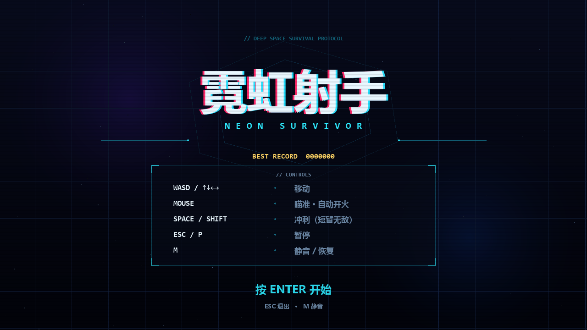
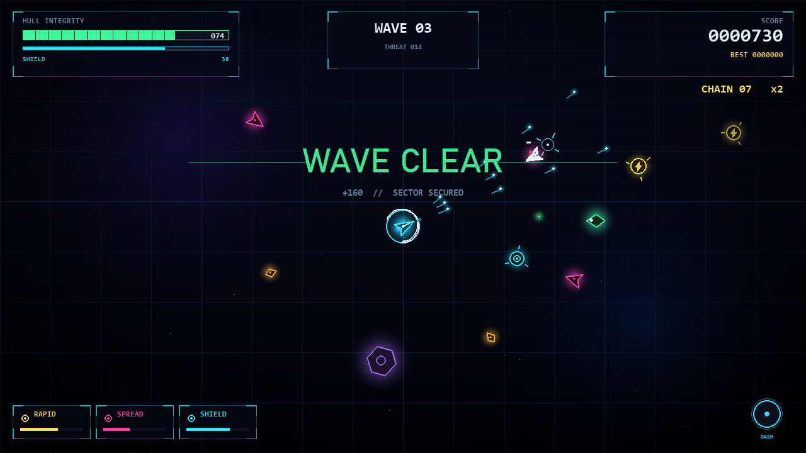
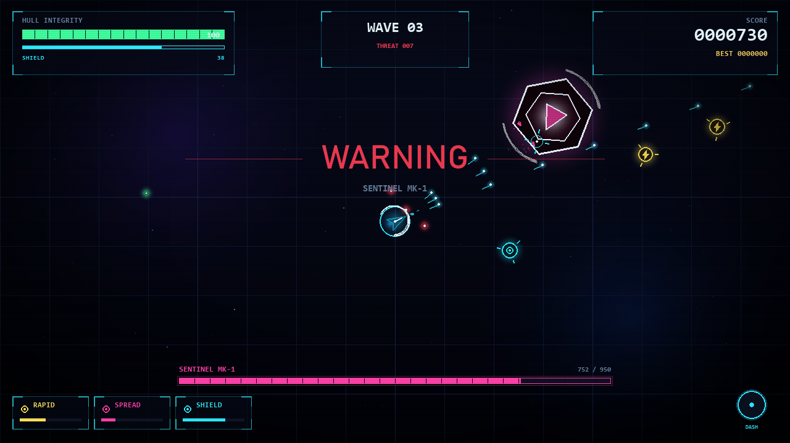

# 霓虹射手 // NEON SURVIVOR

一个用 **Python + Pygame** 从零实现的俯视角霓虹风生存射击小游戏。
所有图形均由代码绘制、所有音效均由代码合成，**不依赖任何外部素材**。

## 运行

```bash
pip install -r requirements.txt
python main.py
```

Windows 下也可以直接双击 `run.bat`。

需要 Python 3.10+（已在 Python 3.13 + pygame 2.6.1 上测试）。

## 操作

| 按键 | 作用 |
| --- | --- |
| `WASD` / 方向键 | 移动 |
| 鼠标 | 瞄准（自动开火，无需点击） |
| `空格` / `Shift` | 冲刺（冲刺期间无敌） |
| `ESC` / `P` | 暂停 / 继续 |
| `M` | 静音 / 恢复 |
| `Enter` | 开始游戏 |
| `R` | 结算或暂停时重新开始 |

## 玩法

- 敌人从屏幕四边涌入，清空一波后自动进入下一波。
- **每 5 波**会出现 Boss「SENTINEL」，血量与攻击频率随波次提升，40% 血量以下进入狂暴。
- **连杀**：2.6 秒内连续击毁敌人可累积连锁，每 4 连杀提升一级得分倍率，最高 `x5`。
- **补给**：击毁敌人有概率掉落，Boss 必定掉落三个。
  - 维修：回复 30 点装甲
  - 急速：射速提升（11 秒）
  - 散射：三连发（11 秒）
  - 护盾：吸收 55 点伤害（10 秒）
- 受击后有短暂无敌帧，冲刺也可以穿过弹幕。
- 最高分自动保存在 `highscore.json`。

## 文件结构

```
main.py          入口：初始化 pygame / 音频，启动游戏
app.py           状态机（标题 / 游戏 / 暂停 / 结算）、输入、抖动、存档
world.py         波次导演、实体管理、碰撞、计分、掉落
entities.py      玩家、敌人、Boss、子弹、补给
ui.py            HUD、菜单、横幅、扫描线、字体加载
utils.py         数学工具、发光缓存、粒子、星空网格背景
audio.py         程序化音效合成（无素材）
settings.py      窗口尺寸、配色、全部数值平衡参数
tools/           冒烟测试与截图脚本（开发用）
```

## 调参

手感、难度、配色全部集中在 `settings.py`：

- `PLAYER_SPEED` / `DASH_*`：移动与冲刺手感
- `GUN_INTERVAL` / `GUN_DAMAGE` / `BULLET_SPEED`：主武器
- `ENEMY_TYPES`：敌人血量、速度、伤害、掉落分
- `BOSS_*`、`WAVE_*`：Boss 与波次节奏
- `POWERUP_*`：补给强度与持续时间

## 开发工具

```bash
python tools/smoke_test.py   # 无头运行约 100 秒，覆盖波次 / Boss / 死亡 / 重开
python tools/screenshots.py  # 无头生成界面截图到 tools/shots/
```

## 预览




